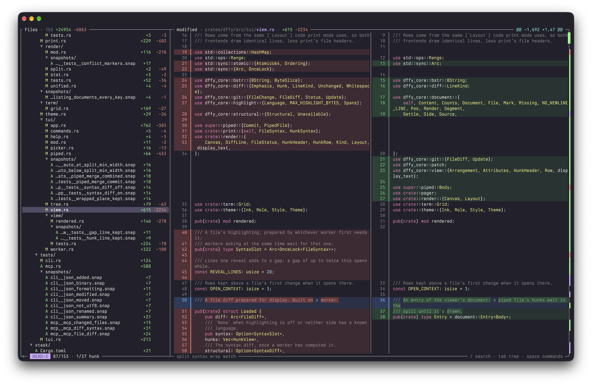
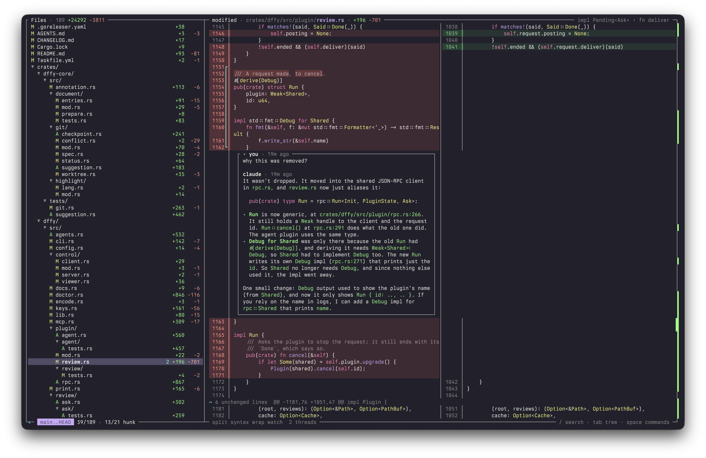

<p align="center"></p>

<h1 align="center">dffy</h1>

<p align="center"><b>A terminal diff viewer for git, written in Rust.</b></p>

<p align="center">Built for large repositories, up to the size of the Linux kernel.</p>

```sh
dffy                   # everything you haven't committed
dffy main..HEAD        # any revision git understands
```

Run `dffy` in a git repository and it opens your changes full screen: a file tree on the left, the diff on the right, split or unified. Pipe it and it prints the diff. It shows the first files while it diffs the rest in the background.

<p align="center">
  
  
</p>

## Install

```sh
brew install --cask amalucelli/tap/dffy
# or
curl -fsSL https://raw.githubusercontent.com/amalucelli/dffy/main/install.sh | sh
```

Then try it in any repository: `dffy HEAD~10`. [install.md](docs/install.md) has mise, building from source and shell completions.

## Usage

```sh
dffy                        # staged, unstaged and untracked changes
dffy --staged               # what's staged (git diff --cached)
dffy HEAD~3                 # a revision against the working tree
dffy main...feature         # changes since the merge base
dffy show HEAD              # a commit with its message
dffy main.. -- src/         # limited to paths
dffy a.txt b.txt            # two files or folders, no repository needed
dffy --watch                # refresh on every change
dffy --syntax v6.0 v6.1     # diff by syntax
dffy --stat main..          # also --name-only, --name-status, --exit-code
dffy --json main..          # JSON Lines for scripts and agents
dffy mcp                    # an MCP server for coding agents
dffy comments --json        # the review comments in this repository
dffy pr 123                 # a GitHub pull request, with dffy-review-github
```

With git:

```sh
git config --global core.pager dffy
git config --global interactive.diffFilter "dffy --color-only"
```

In the viewer, `n`/`N` move between changes, `f`/`F` between files, `/` searches, `o` finds a file, `space` lists commands and `q` quits. Settings go in `~/.config/dffy/config` as `key = value` lines. `dffy config --default` lists every key with its default.

## Plugins

Plugins are separate programs that dffy runs when your config names them. All are experimental.

| Plugin | What it adds | Homebrew |
|---|---|---|
| `dffy-render-markdown` | Markdown files diffed as rendered text, with Mermaid fences drawn | `brew install --cask amalucelli/tap/dffy-render-markdown` |
| `dffy-render-mermaid` | `.mmd` and `.mermaid` flowcharts and sequence diagrams drawn in the terminal | `brew install --cask amalucelli/tap/dffy-render-mermaid` |
| `dffy-review-github` | GitHub pull request reviews: `dffy pr 123`, threads inline, post your review. Needs [`gh`](https://cli.github.com), logged in. | `brew install --cask amalucelli/tap/dffy-review-github` |
| `dffy-agent` | Ask (`a`): Claude Code, Codex or Pi answers a review thread as a reply in it, read-only, with a suggestion when it proposes a change. Needs `claude`, `codex` or `pi`, logged in. | `brew install --cask amalucelli/tap/dffy-agent` |

Or with the install script: `… | sh -s -- --plugin markdown --plugin mermaid --plugin review-github --plugin agent`.

Then turn them on in `~/.config/dffy/config`:

```
render = md:markdown mmd:mermaid mermaid:mermaid
review = github
```

- `r` switches a Markdown or Mermaid file between its lines and its rendered form.
- `dffy pr 123` opens a pull request. Plain `dffy` on a branch with an open PR brings in its comments.
- `dffy-agent` needs no config line. Once it's on `PATH`, `a` on a thread asks.
- Fix with agent (`f` on a thread) needs no plugin. It hands the thread to Claude Code, Codex, Pi or Amp in a new tab.
- `dffy doctor` checks that each plugin is found, and that `gh` and the agents are logged in.

[plugins.md](docs/plugins.md) has the details.

## Agents

Your coding agent can use dffy to read a change a file at a time, answer the review threads you leave it, and show you a line in your viewer.

```sh
dffy agents setup    # a skill for Claude Code, Codex, Pi and Amp
```

The skill tells the agent to run `dffy agents show`, which prints how to use the installed dffy. It also tells the agent to reply in your threads under its own name and never resolve or post them. Agents without a shell use [`dffy mcp`](docs/mcp.md) instead. [agents.md](docs/agents.md) has the details.

## Why `dffy`

`dffy` builds on tools I like: the terminal review flow of [`lumen`](https://github.com/jnsahaj/lumen), the review UX of [`hunk`](https://hunk.dev), and the rendering of [diffs.com](https://diffs.com) (Pierre's `@pierre/diffs`). None of them fit how I work. `lumen` builds in its own AI features, with its own model keys and providers, and I wanted the viewer to work with the agent I already use. `hunk` is TypeScript on a JavaScript runtime, and I wanted a single native binary that stays fast on huge repos. diffs.com runs in the browser. So I built a native terminal diff viewer that works the same on a laptop and over SSH from a phone.

## Features

**Fast**
- ⚡ [Opens the Linux v6.0..v6.1 diff in less than 10ms](docs/benchmarks.md) and loads the rest in the background.
- 👀 [`--watch`](docs/watch.md) repaints as you edit, stage and commit.

**Reading diffs**
- 🪟 [Split or unified](docs/config.md#settings), picked by terminal width.
- 🌈 Syntax highlighting for 30 languages, with [changed words emphasized](docs/viewer.md#modified-lines).
- 🌳 [A syntax-aware diff](docs/architecture.md#the-engine) (`d`) that marks reformatted (`~`) and moved (`»`) code.
- 🔁 Renames detected the way git detects them.

**Navigation**
- 🗂️ [A file tree](docs/viewer.md#panels), a fuzzy file picker and [search across the diff](docs/viewer.md#search).
- 🎯 [Each file opens at its first change](docs/viewer.md#where-a-file-opens), and `n`/`N` jump between changes.
- ⌨️ [Single-key actions](docs/keys.md), with a [command panel](docs/viewer.md#panels) on `space`.

**Reviewing**
- 💬 [Review comments](docs/comments.md) on lines and files, drawn under their code, with replies, resolve and suggestions. They're kept in a plain file in the repository's git directory.
- 🗒️ A [Comments panel](docs/viewer.md#the-comments-panel) beside the file tree. Picking a thread takes the diff to it.
- 🔀 [Code host reviews](docs/viewer.md#code-host-reviews) (experimental). With the `dffy-review-github` plugin, `dffy pr 123` opens a GitHub pull request with its threads, posts your review, and follows new pushes.
- 🤝 [Ask](docs/viewer.md#asking-an-agent) a coding agent (experimental). With the `dffy-agent` plugin, `a` on a thread has Claude Code, Codex or Pi answer in it, read-only. [Apply suggestion](docs/viewer.md#applying-a-suggestion) (`s`) puts a thread's suggestion in the working tree.
- 🛠️ [Fix with agent](docs/viewer.md#fixing-with-an-agent) (`f`) hands a thread to your own agent session in a new tab. [Copy as prompt](docs/viewer.md#copying-a-thread) and [Open terminal here](docs/viewer.md#opening-a-terminal) are in the command panel.

**Git**
- 🧾 [Staged, unstaged and untracked](docs/git.md#staged-unstaged-and-untracked) changes in one view, or [any revision](docs/usage.md#what-to-compare).
- ⚔️ [Conflicted files](docs/git.md#staged-unstaged-and-untracked) from a merge, rebase or cherry-pick, with their conflict markers highlighted.
- 📟 Works as [git's pager](docs/git.md#as-gits-pager), [`git add -p` filter](docs/git.md#git-add--p) and [difftool](docs/git.md#git-difftool).
- 📁 [Compares files and folders](docs/usage.md#comparing-files-and-folders) outside a repository too.

**Anywhere**
- 📱 [Works on phones over SSH](docs/viewer.md#phones-and-small-screens), with plain-letter keys and a frameless layout.
- 🖱️ [Mouse selection](docs/viewer.md#selection-and-copy) that copies over SSH.
- 🎨 [16 themes](docs/themes.md) and a [config file](docs/config.md) for your dotfiles.
- 🧩 [Plugins](docs/plugins.md) (experimental): renderers that diff Markdown as rendered text and draw Mermaid flowcharts and sequence diagrams, and review plugins that connect dffy to a code host.

**Scripts and agents**
- 🧱 [`--json`](docs/json.md): the diff as JSON Lines, with each line's kind and whether it moved or was only reformatted.
- 🧠 [`dffy agents setup`](docs/agents.md): a skill that teaches Claude Code, Codex, Pi and Amp to read changes and answer your threads with dffy's CLI.
- 🤖 [`dffy mcp`](docs/mcp.md): an MCP server. Coding agents list a change's files, read its diffs a page at a time, read your review comments, and reply in a thread or apply its suggestion.
- ✍️ [`dffy comments`](docs/comments.md): review comments as JSON. Scripts and agents add their own with `dffy comments apply`, shown inline with their author.

## Comparison

| | `dffy` | `hunk` | `lumen` | `difftastic` | `delta` | `diff-so-fancy` | `diff` |
|---|:-:|:-:|:-:|:-:|:-:|:-:|:-:|
| Interactive viewer with a file tree | ✅ | ✅ | ✅ | ❌ | ❌ | ❌ | ❌ |
| Watch mode | ✅ | ✅ | ✅ | ❌ | ❌ | ❌ | ❌ |
| git's pager (reads a diff on stdin) | ✅ | ✅ | ❌ | ❌ | ✅ | ✅ | ❌ |
| `git add -p` filter | ✅ | ❌ | ❌ | ❌ | ✅ | ✅ | ❌ |
| Syntax highlighting | ✅ | ✅ | ✅ | ✅ | ✅ | ❌ | ❌ |
| Changed-word emphasis | ✅ | ✅ | ✅ | ✅ | ✅ | 🟡 | ❌ |
| Syntax-aware diff | ✅ | ❌ | ❌ | ✅ | ❌ | ❌ | ❌ |
| Split and unified, picked by width | ✅ | ✅ | ❌ | 🟡 | 🟡 | ❌ | 🟡 |
| Mouse | ✅ | ✅ | ✅ | ❌ | ❌ | ❌ | ❌ |
| Compares files outside a repository | ✅ | 🟡 | ❌ | ✅ | ✅ | 🟡 | ✅ |
| Plugins or extensions | 🟡 | 🟡 | ❌ | ❌ | ❌ | ❌ | ❌ |
| Single native binary | ✅ | 🟡 | ✅ | ✅ | ✅ | ❌ | ✅ |
| Your own line comments | ✅ | 🟡 | ✅ | ❌ | ❌ | ❌ | ❌ |
| GitHub pull request review | 🟡 | 🟡 | 🟡 | ❌ | ❌ | ❌ | ❌ |
| AI or agent annotations | ✅ | ✅ | 🟡 | ❌ | ❌ | ❌ | ❌ |
| Other VCSs (Jujutsu, Mercurial, Sapling) | ❌ | ✅ | ✅ | ✅ | ✅ | 🟡 | — |

🟡 means partial support. All seven are open source. GNU diff is GPL-3.0-or-later and the rest are MIT. Checked against `hunk` 0.25.0, `lumen` 2.32.0, `difftastic` 0.72.0, `delta` 0.20.1, `diff-so-fancy` 1.4.14 and GNU diffutils 3.10, with [a source for every cell](docs/benchmarks.md#feature-comparison-sources).

## Benchmarks

Opening Linux v6.0..v6.1 (13,168 changed files, a 48MB patch) in a viewer, time until the first changed line is on screen:

| | `dffy` | `lumen` 2.32.0 | `hunk` 0.25.0 |
|---|--:|--:|--:|
| The v6.0..v6.1 range | 8.1ms | 12.5s | 18.1s |
| The working tree (5 files changed) | 77ms | 1.11s | 733ms |
| As a pager, `git diff v6.0 v6.1 \| …` | 210ms | n/a | 15.2s |
| Memory, opening the range | 99MB | 676MB | 4.39GB |

As git's pager, `dffy` streams the whole 48MB patch in 3.1MB of its own memory, about as fast as plain `git diff`.

## Architecture

- 📚 [A library at its core](docs/architecture.md#crates), `dffy-core`: the diff model that the viewer, printed output, JSON and the MCP server share.
- 🧮 [Its own diff engine](docs/architecture.md#the-engine): histogram and syntax-aware diffs, and renames that match git's.
- 🖼️ [Its own terminal renderer](docs/architecture.md#the-renderer), with no TUI framework. A full frame takes about 150µs.
- 🌊 [Streamed input and output](docs/architecture.md#data-flow), so the first screen doesn't wait for the whole diff.
- 🛰️ [One shared watcher per repository](docs/architecture.md#watcher-and-broker), however many views are open.

[docs/design.md](docs/design.md) has the approach a change follows, for contributors and coding agents.

## Docs

The [documentation](docs/README.md) covers every key, flag and setting: [installation](docs/install.md), [usage](docs/usage.md), [the viewer](docs/viewer.md), [keys](docs/keys.md), [configuration](docs/config.md), [themes](docs/themes.md), [git integration](docs/git.md), [watch mode](docs/watch.md), [review comments](docs/comments.md), [plugins](docs/plugins.md), [JSON output](docs/json.md), [coding agents](docs/agents.md), [the MCP server](docs/mcp.md), [troubleshooting](docs/troubleshooting.md), [architecture](docs/architecture.md) and [benchmarks](docs/benchmarks.md). [CHANGELOG.md](CHANGELOG.md) lists what each release changed.

## License

MIT
